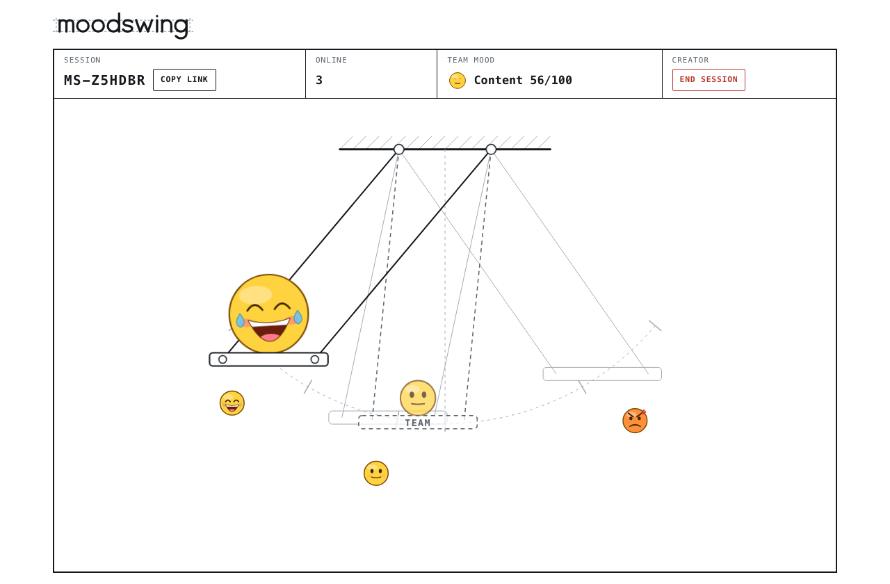

# moodswing

A team mood meter shaped like a swing.

Start a session and share the link. Everyone drags their own swing towards **laughing** (left) or **angry** (right), and the emoji riding the swing morphs smoothly between the two. Every mood shows up live and anonymously for the whole team, and a see-through "team" swing hangs at the average. When you're done, the person who started the session ends it and everyone sees the final results. "moodswing soothing" then lets go of every swing on everyone's screen and lets them all swing gently into **content**. "Start again" reopens the same session with no moods, so the link you already shared keeps working.



## How it works

```
Browser ──https──> CloudFront ──> S3 (React app + config.json)
   └──wss──> API Gateway WebSocket API ──> Lambda (Node 24) ──> DynamoDB
                     <── @connections push to everyone in the session
```

- **Client** (`src/`): React 18 + Vite. The swing diagram and the emoji faces are hand-built SVG. Dragging uses pointer events, and on release a damped spring wobbles the swing before it settles on the chosen mood. The arrow keys work too.
- **Backend** (`backend/`): a single Lambda handles every WebSocket route. Sessions, votes and connections live in one DynamoDB table and expire after 24 hours through TTL. Restarting a session bumps its round, so earlier votes stop counting without deleting them.
- **Shared** (`shared/`): the mood scale and the message protocol that client and Lambda both import.
- **Infrastructure** (`cdk/`): one CDK stack that creates the table, Lambda, WebSocket API, S3 bucket, CloudFront distribution and the deployment of the built client.

## Local development

Needs Node 24 (`nvm use`).

```sh
npm install
npm run dev          # http://localhost:5173
```

The Vite dev server also runs the real session logic on an in-memory store at `/dev-ws`, so the app works fully offline. Open the session link in a second window to see live updates. Sessions disappear when the dev server stops.

- `npm run dev:network` serves on your LAN to try touch dragging on a phone.
- Set `VITE_WS_URL` (see `.env.example`) to run the dev client against a deployed backend.

## Tests

```sh
npm test             # shared, backend and client specs
npm run build        # type-check and production build
cd cdk && npm test   # CDK stack assertions
```

## Deploying

See [DEPLOYMENT.md](DEPLOYMENT.md).
